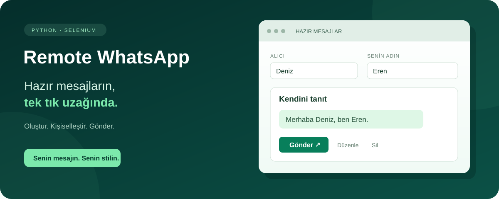

<div align="center">



# Remote WhatsApp

**Aynı mesajı tekrar tekrar yazma. Kendi mesaj koleksiyonunu oluştur.**

WhatsApp Web için kişiselleştirilebilir hazır mesajlar, canlı önizleme ve tek tıkla gönderim.


[Başla](#baslangic) · [Mesajlarını oluştur](#mesajlar) · [Komutlar](#komutlar) · [Gizlilik](#gizlilik) · [Geliştirme](#gelistirme)

<sub>Üstteki görsel, hazır mesaj akışının temsili çizimidir.</sub>

</div>

---

<a id="ozellikler"></a>

## ✨ Küçük bir panel, kullanışlı kısayollar

Bir tanışma mesajı, kısa bir teşekkür veya görüşme isteği… Sık kullandığın metinleri bir kez kaydet; alıcıyı ve kendi adını gir, önizlemeyi kontrol et, gönder.

| Özellik | Sana ne sağlar? |
| --- | --- |
| ⚡ **Tek tıkla gönderim** | Hazır mesaj kartından doğrudan WhatsApp'a gönder. |
| ✏️ **Sana ait bir koleksiyon** | Mesaj ekle, metnini düzenle, kullanmadıklarını sil. |
| 🪄 **Kişiselleştirilebilir metinler** | `{ad}` ve `{alici}` alanlarıyla aynı mesajı farklı kişilere uyarla. |
| 👀 **Canlı önizleme** | Adları değiştirdikçe gönderilecek metni kartta gör. |
| 💾 **Kalıcı yerel kayıt** | Kaydettiğin mesajları uygulamayı yeniden açınca kullan. |
| 🎙️ **Ek araçlar** | Komut satırında Türkçe ses tanıma ve deneysel sohbet verisi toplama. |

<a id="baslangic"></a>

## 🚀 Üç komutla başla

**Gerekenler:** Python 3.11+, Google Chrome ve internet bağlantısı.

Proje klasöründe PowerShell'i aç:

```powershell
python -m venv .venv
.\.venv\Scripts\python.exe -m pip install -r requirements.txt
.\.venv\Scripts\python.exe main.py
```

Panel açılınca:

1. **Alıcı** alanına WhatsApp sohbetindeki tam adı yaz.
2. **Senin adın** alanını doldur.
3. Mesajın önizlemesini kontrol et ve **Gönder ↗** düğmesine tıkla.

İlk gönderimde açılan Chrome penceresinde QR kodunu telefonunla okut. Uygulama giriş için 120 saniyeye kadar bekler; sonraki kullanımlarda aynı yerel Chrome profilini kullanır. Selenium gerektiğinde tarayıcı sürücüsünü indirir.

> **Gönder ↗ gerçek mesaj gönderir; ayrıca onay sorulmaz.** Alıcı görünür sohbet listesinde bulunmalıdır. Teslim durumunu WhatsApp üzerinden kontrol et.

<details>
<summary><strong>Linux ve ses kaydı hakkında</strong></summary>

Tkinter, Windows'taki standart Python kurulumunda bulunur. Linux'ta dağıtımına göre `python3-tk` ve ses kaydı için PortAudio sistem paketleri gerekebilir. Ses tanıma özelliği mikrofon ve internet bağlantısı kullanır.

</details>

<a id="mesajlar"></a>

## 🪄 Mesajların senin tarzında olsun

**+ Yeni mesaj** ile bir başlık ve metin ekle. İlk açılışta tanışma, müsaitlik sorma ve teşekkür için üç örnek hazır gelir.

| Düğme başlığı | Kaydedeceğin mesaj |
| --- | --- |
| 👋 Kendini tanıt | `Merhaba {alici}, ben {ad}.` |
| 📅 Görüşme iste | `Merhaba {alici}, bugün konuşmak için müsait misin?` |
| 🙏 Teşekkür et | `Yardımın için teşekkür ederim {alici}!` |

**Alıcı:** Deniz · **Senin adın:** Eren

```text
Merhaba Deniz, ben Eren.
```

**Kaydet** ile koleksiyonuna ekle; karttaki **Düzenle** ve **Sil** düğmeleriyle yönet. Çok satırlı metinler de desteklenir.

| Alan | Karşılığı |
| --- | --- |
| `{ad}` | Senin adın; mesaj bu alanı kullanıyorsa doldurman gerekir. |
| `{alici}` | Alıcı kutusuna yazdığın sohbet adı. |
| `{{` ve `}}` | Mesajda düz süslü parantez göstermek için kullanılır. |

Mesajlar `message_templates.json` dosyasında yerel olarak saklanır. Bu dosya Git'e dahil edilmez.

<a id="komutlar"></a>

## ⌨️ Terminalden de kullan

```powershell
# Hazır mesaj paneli
.\.venv\Scripts\python.exe main.py gui

# Belirtilen sohbete gerçek mesaj gönder
.\.venv\Scripts\python.exe main.py send "Örnek Kişi" "Merhaba"

# Beş saniyelik Türkçe sesi yazıya çevir
.\.venv\Scripts\python.exe main.py listen

# Görünür sohbetlerden veri toplamayı dene
.\.venv\Scripts\python.exe get_data.py

# Yardım
.\.venv\Scripts\python.exe main.py --help
```

`listen` kaydı Google ses tanıma hizmetine gönderir. Sesi yalnızca yazıya çevirir; sesli komuttan mesaj gönderme uygulanmamıştır.

`get_data.py`, ilk 49 sohbet satırını farklı seçicilerle taramayı dener ve sonucu `whatsapp_data.json` dosyasına yazar. İşlem birkaç dakika sürebilir; tüm rehberin eksiksiz dışa aktarımı değildir. Alınamayan numaralar için `null` kaydedilir. Örnek veri yapısı: [whatsapp_data.example.json](whatsapp_data.example.json).

<a id="gizlilik"></a>

## 🔐 Verilerin nerede kalır?

| Yerel dosya / klasör | İçerik | Git'e dahil mi? |
| --- | --- | --- |
| `message_templates.json` | Özelleştirdiğin hazır mesajlar | Hayır |
| `whatsapp_data.json` | Toplanan kişi ve telefon verileri | Hayır |
| `.chrome-profile/` | Chrome profili ve WhatsApp oturumu | Hayır |
| `.env`, `.venv/`, `venv/` | Yerel ayarlar ve Python ortamları | Hayır |

JSON dosyaları **şifrelenmez**. Git dışında tutulmaları, bilgisayarındaki erişimlere karşı koruma sağlamaz. Chrome oturum klasörünü paylaşma. `listen` özelliğini kullanırsan ses kaydı Google'a iletilir.

Gönderim sırasında düğmeler kilitlenir. Görünür listede aynı adlı birden fazla sohbet varsa veya açık sohbette taslak bulunursa işlem durur. Özel klavye komutu olarak yorumlanabilecek karakterler mesajlarda engellenir.

<details>
<summary><strong>⚙️ Profil ve dosya yollarını özelleştir</strong></summary>

Varsayılan Chrome profili günlük kullandığın profilden ayrıdır. Aynı profili kullanan iki betiği eşzamanlı çalıştırma.

| Ortam değişkeni | Varsayılan |
| --- | --- |
| `WHATSAPP_CHROME_USER_DATA_DIR` | `.chrome-profile` |
| `WHATSAPP_CHROME_PROFILE` | Chrome'un varsayılan profili |
| `WHATSAPP_DATA_FILE` | `whatsapp_data.json` |

Göreli yollar proje klasörüne göre çözülür. PowerShell örneği:

```powershell
$env:WHATSAPP_CHROME_USER_DATA_DIR = ".chrome-profile"
$env:WHATSAPP_CHROME_PROFILE = "Default"
```

[.env.example](.env.example) başvuru içindir; `.env` dosyaları otomatik yüklenmez. Özel bir çıktı veya profil konumu seçersen onu da Git dışında tut.

</details>

<a id="gelistirme"></a>

## 🛠️ Geliştirmek isteyenlere

```text
remote_whatsapp/
├── main.py          # Başlatıcı ve WhatsApp mesaj gönderimi
├── gui.py           # Hazır mesaj paneli ve düzenleyici
├── templates.py     # Şablon doğrulama, kişiselleştirme ve kayıt
├── config.py        # Taşınabilir yollar ve Chrome ayarları
├── get_data.py      # Deneysel sohbet verisi toplama
├── tests/           # Arayüz, gönderim ve veri testleri
└── requirements.txt # Bağımlılıklar ve güvenli alt sürüm sınırları
```

Testleri çalıştır:

```powershell
.\.venv\Scripts\python.exe -m unittest discover -s tests -v
```

Testler gerçek mesaj göndermez, WhatsApp oturumu açmaz ve mikrofonu kullanmaz. Arayüz testleri ekran olmayan ortamlarda atlanır.

GitHub Actions, Python **3.11 ve 3.14** üzerinde testleri ve `pip-audit` bağımlılık taramasını çalıştıracak şekilde yapılandırılmıştır. Dependabot, Python paketleri ve Actions güncellemelerini haftalık kontrol edecek şekilde ayarlanmıştır.

<details>
<summary><strong>GitHub'a ilk yükleme</strong></summary>

```powershell
git status --short
git add .
git diff --cached --stat
git commit -m "Prepare Remote WhatsApp for GitHub"
git remote add origin https://github.com/USERNAME/REPOSITORY.git
git push -u origin main
```

Depo adresini kendi adresinle değiştir. Commit öncesinde eklenen dosyaları incele.

</details>

## 📌 Projenin durumu

Bu proje **prototip aşamasındadır**. Gerçek WhatsApp oturumu ve mikrofonla uçtan uca doğrulama henüz yapılmadı. Mesaj gönderimi ve veri toplama WhatsApp Web'in sayfa yapısına bağlıdır; sayfa değiştiğinde seçicilerin güncellenmesi gerekebilir.

WhatsApp veya Meta ile bağlantılı resmî bir ürün değildir.

---

<div align="center">
<sub>Bir mesaj koleksiyonu. Daha az tekrar. Kendi kelimelerin.</sub>
</div>
